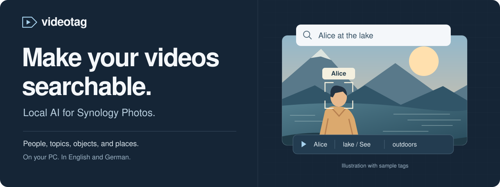
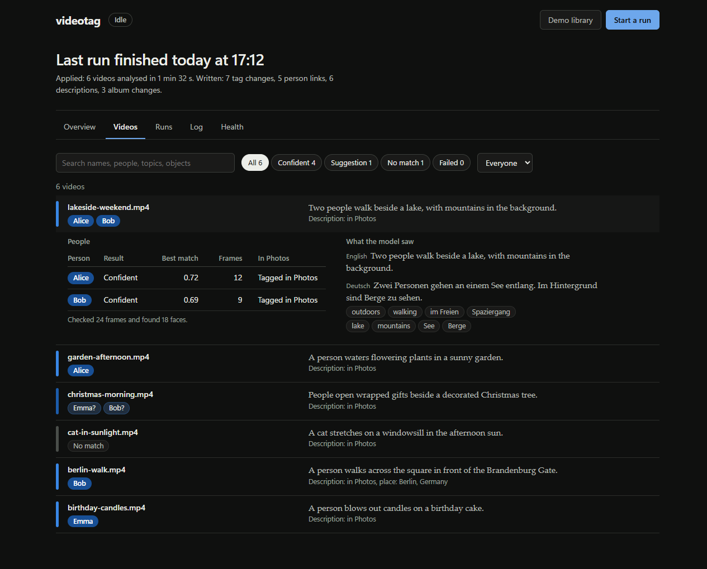
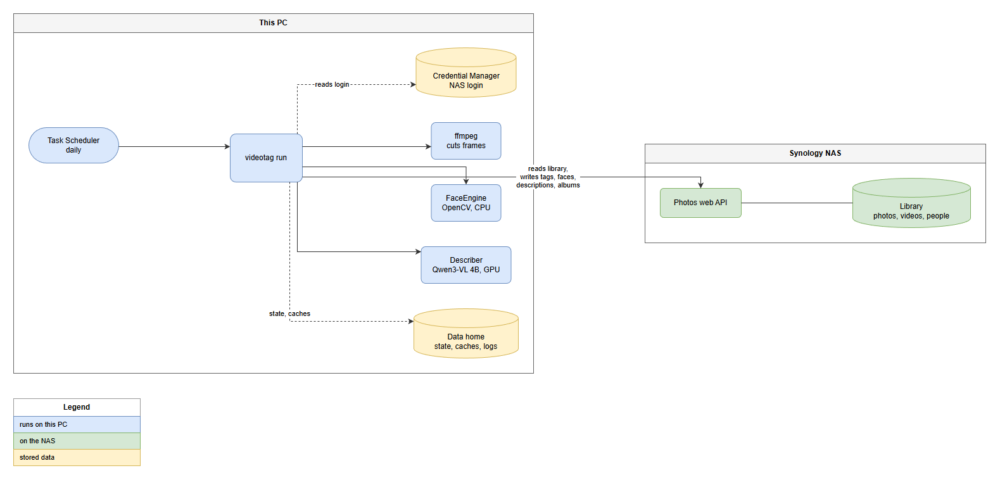

<p align="center">
  
</p>

# videotag · Local AI video tagging for Synology Photos

**Find the people and moments in your videos, right inside Synology Photos.**

videotag adds **video face recognition, automatic tagging, and AI video descriptions** to your Synology Photos library. It runs on your Windows PC, matches video frames against the people you have already named in Photos, and makes videos searchable by **people, topics, objects, and visible places**.

<p>
  <a href="https://github.com/AIPris/videotag/actions/workflows/tests.yml"></a>
  <a href="#requirements"></a>
  <a href="#requirements"></a>
  <a href="#privacy-and-control"></a>
  <a href="#project-status"></a>
</p>

[**Get started**](#quick-start) · [Dashboard](#dashboard) · [User guide](docs/howto.md) · [How it works](#how-it-works) · [FAQ](#faq) · [Roadmap](docs/roadmap.md)

## Your library, easier to find

| Find… | What videotag adds to Synology Photos |
|---|---|
| **The people in a video** | Face matching against your named people. Confident matches get a name tag and appear on that person's People page. |
| **The moment you remember** | Searchable descriptions, topics, and objects in **English and German**: try `cat`, `Katze`, `scuba`, or `Weihnachtsbaum`. |
| **A place shown on screen** | Place names when a landmark or readable sign supplies evidence. No invented GPS coordinates. |
| **Matches worth checking** | A `Name?` tag marks a suggestion, collected in the shared `videotag: to check` album. Confirm or reject it in Photos. |

Your existing descriptions stay in place. Generated text lives in a separate `[vt] ... [/vt]` block, and videotag respects the corrections you make in Photos.

## Dashboard

See results as a run progresses, browse matches and descriptions, inspect the face crops behind a match, draw a spot-check sample, and check the log from a local browser dashboard.



<sub>The actual dashboard with fictional sample data. Names, filenames, and results are illustrative.</sub>

```powershell
videotag gui
```

Opens at `http://127.0.0.1:8765/`. The dashboard can start dry runs and apply runs, show scheduled runs, and switch Synology accounts. Settings controls the sampling preset and descriptions; dry runs can cover a limited number of videos, unanalysed videos, or one album. **Undo** removes the tool's tracked changes after confirmation. The command line also works on its own for unattended processing.

[Dashboard guide](docs/howto.md#dashboard-optional) · [Schedule a daily run](docs/howto.md#run-it-every-day)

## Requirements

| Component | What you need |
|---|---|
| Synology NAS | **Synology Photos on DSM 7**, a personal space, and people named in the People view |
| Computer | **Windows 10/11**; developed and tested on Windows 11 |
| Python | **3.11 or newer**; tested with Python 3.13 |
| Video tools | **ffmpeg** on `PATH`; `ffmpeg -version` should work |
| GPU for descriptions | NVIDIA GPU with about **10 GB of free VRAM**; face matching alone runs on the CPU |
| Storage | About **15 GB** for the description setup, plus caches that grow with your library |

Use a dedicated, non-admin Photos account with access to the personal space you want to process. Give each named person at least three reference photos for confident matching. [Full prerequisites](docs/howto.md#what-you-need)

## Quick start

### 1. Install

Run these commands in PowerShell with the Python interpreter you intend to use for videotag:

```powershell
git clone https://github.com/AIPris/videotag.git
cd videotag

# CUDA-enabled PyTorch for local video descriptions
python -m pip install torch --index-url https://download.pytorch.org/whl/cu128
python -m pip install --no-user -e ".[describe]"
```

<details>
<summary><strong>No NVIDIA GPU? Install for people tagging only.</strong></summary>

Skip PyTorch and the description dependencies:

```powershell
git clone https://github.com/AIPris/videotag.git
cd videotag
python -m pip install --no-user -e "."
```

Use `videotag run --no-describe` for the dry run and `videotag run --no-describe --apply --max-writes 5` for the first write. In the dashboard, uncheck **Describe videos**. The `doctor` warning about missing `torch/transformers` is expected with this setup. If those libraries are already installed without a CUDA GPU, the descriptions check reports a failure; people tagging still works with `--no-describe`. Resolve failures in the other checks before running.

</details>

### 2. Connect and check

```powershell
videotag credentials set
videotag doctor
```

Enter your NAS HTTPS address, account, and password when prompted. Credentials are stored in Windows Credential Manager. Before running, name the people in Synology Photos so videotag has reference faces to match.

### 3. Preview, then apply

```powershell
# Analyse the library and preview changes; writes nothing to Photos
videotag run

# After reviewing the dry run, try a small batch of writes
videotag run --apply --max-writes 5
```

**Dry run is the default.** The write limit applies to each kind of change, including tags, person links, descriptions, and album items. The first run downloads the models and analyses your library, so allow extra time; later runs reuse cached results.

Check the results in Photos before increasing the limit; `--max-writes all` removes the cap. See the [first-run guide](docs/howto.md#first-run-a-dry-run) for details and the [troubleshooting guide](docs/howto.md#troubleshooting) if a check fails.

## How it works

1. **Learn the named faces.** Read the people and reference photos already in Synology Photos.
2. **Analyse videos locally.** Sample frames, match faces with OpenCV, and optionally generate descriptions with the local Qwen3-VL-4B model.
3. **Write back to Photos.** Apply tags, People-page links, description blocks, and album updates through the Photos web API.
4. **Respect your corrections.** Read your changes on the next run and remember rejected matches and edited descriptions.

<details>
<summary><strong>See the system overview</strong></summary>



Read the [architecture guide](docs/architecture.md) for the modules, data flow, caching, and feedback rules.

</details>

## Privacy and control

- **Local AI processing.** Faces, frames, and descriptions are processed on your PC. No cloud AI service or telemetry. Setup downloads Python packages and model files; library traffic goes to your NAS.
- **Preview before writing.** Nothing is written to Photos without `--apply`. Use `--max-writes` to keep the first batch small.
- **Your edits take priority.** Remove a match, confirm a suggestion, or edit a generated description in Photos. videotag remembers your choices.
- **Undo the tool's changes.** `videotag undo`, or **Undo** in the dashboard, removes the tags, links, description blocks, and albums it tracks, while preserving your own content and edited descriptions. See [maintenance](docs/howto.md#maintenance).
- **Protected credentials.** OS credential storage, HTTPS, and certificate verification. Cached photos and face embeddings stay in the local data folder and should be protected like the original media.

[Security and data storage](docs/security.md) · [Correcting results](docs/howto.md#correcting-results)

## FAQ

### Does videotag run on the Synology NAS?

It runs on your Windows PC and connects to Synology Photos over HTTPS. It is a Python tool with an optional local dashboard, not a DSM package. The NAS remains the home of your library.

### Do I need a GPU for face recognition?

No. People tagging runs on the CPU. The NVIDIA GPU is needed for AI video descriptions; pass `--no-describe` to skip those.

### Can I search in German?

Yes. Generated descriptions, topics, and objects include English and German, so both `cat` and `Katze` can help you find the same video. The model can make mistakes, including awkward German wording.

### Will it modify my original video files?

videotag writes Photos metadata through the web API. It downloads videos temporarily for analysis and does not re-encode or replace the originals on your NAS.

### Is this an official Synology project?

No. videotag is an independent project and is not affiliated with or endorsed by Synology. Some face-link APIs are undocumented and may change with Photos updates.

## Documentation

| Guide | Start here when you want to… |
|---|---|
| [User guide](docs/howto.md) | Install, connect, schedule runs, correct results, or troubleshoot |
| [Architecture](docs/architecture.md) | Understand the processing pipeline and feedback loop |
| [Security](docs/security.md) | Review credentials, caches, biometric data, and network traffic |
| [Synology Photos API notes](docs/synology-photos-api.md) | See the endpoints used and their known quirks |
| [Roadmap](docs/roadmap.md) | Follow planned improvements and evaluation work |

## Project status

**Version 0.1 · Proof of concept.** Verified on one DS224+ running DSM 7.4.1, with Windows 11 and Python 3.13. Start with a dry run and review the results on your own library.

Face matching and description quality have not been audited against a large library. The 4B description model can over-interpret scenes. Places require visible evidence; the Photos map needs GPS data that videotag does not invent. Scheduling instructions are provided, but a scheduled task has not yet been validated on the reference machine.

The face-link integration builds on API research by [synopticon](https://github.com/fdebijl/synopticon). A Synology Photos update may require adjustments.

**License:** no license has been chosen yet.

## Development and feedback

Found a bug or have an idea? [Open an issue](https://github.com/AIPris/videotag/issues) with the steps to reproduce it and your Python, DSM, and Photos versions. Remove credentials, private hostnames, personal filenames, and names from logs before sharing them. For security concerns, follow the [security reporting guidance](docs/security.md#reporting-a-problem).

```powershell
python -m pip install --no-user -e ".[dev]"
python -m pytest
ruff check .
node --test tests/gui_app.test.cjs
```

The tests use no NAS, no GPU, and no real credential store. Dashboard regression tests use Node.js 22+ and its built-in test runner, with no npm dependencies. [View the test workflow](https://github.com/AIPris/videotag/actions/workflows/tests.yml).
