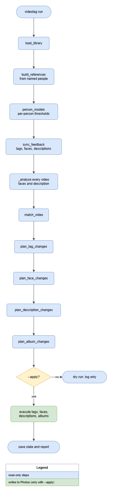
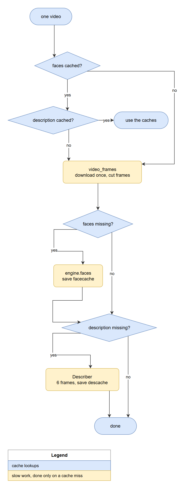
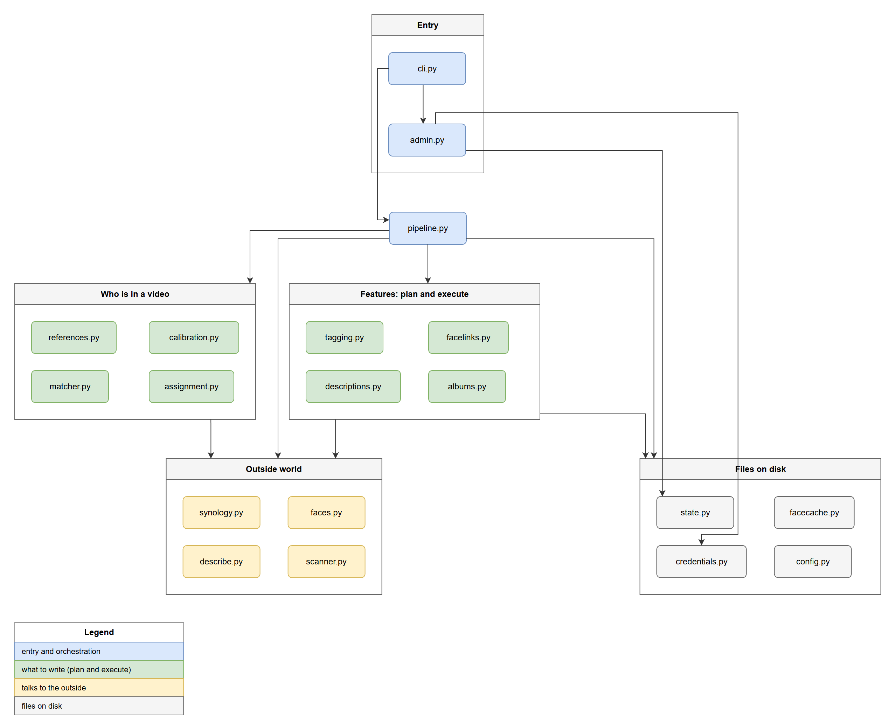

# Architecture

`videotag` is a command-line program with no server and no database. A run reads the Photos library through its web API, analyses the videos it has not seen, decides what to write, and writes it back. Everything it needs to remember is a few small files in one data folder. Diagram sources (`.mmd`, editable `.drawio`) are in `docs/diagrams/`.


| Piece | Role |
|---|---|
| **Task Scheduler** | Starts `videotag run --apply` once a day. A lock file stops two runs overlapping. |
| **videotag** | The program: orchestration, decisions, and the adapters to the outside world. |
| **ffmpeg** | Cuts frames out of a video (handles HEVC and rotation metadata). |
| **FaceEngine** | OpenCV YuNet (finds faces) and SFace (turns a face into a 128-number embedding). CPU. |
| **Describer** | Qwen3-VL 4B on the GPU: reads 6 frames and writes a bilingual description. Loaded only when a video needs describing. |
| **Credential Manager** | Holds the NAS login, encrypted for the Windows user. |
| **Data home** | `state/` (what was written, user feedback, per-video caches), `cache/`, `models/`, `logs/`, `reports/`. |
| **Photos web API** | The only way in and out of the library. Photos itself stores the results: tags, face records, descriptions, albums. |

## One run



1. **load_library**: all photos and videos with their tags, people and descriptions. A dry run that was given an album checks it now, before the long step below.
2. **build_references**: for every *named* person, collect known faces (see below). The faces found in each photo are kept per photo (`state/reffaces/`), so only new or changed photos are read; the phase writes a counter (`references: 600 of 2432 photos`) to the log.
3. **person_models**: one model per person with its own similarity threshold. The accuracy report (`reports/accuracy.json`) is worked out here from the same data.
4. **sync_feedback**: compare what the tool wrote last time with what is in Photos now, to learn what the user rejected or confirmed.
5. **analyse_videos**: faces and description of every video, from the caches where possible. A dry run may look at a slice only (`--limit`, `--new-only`, `--album`); a real run always covers the whole library. The next videos are fetched and read on a helper thread while the vision-language model describes the current one (see below). Each result is also appended to `reports/current-run.jsonl` as it is made, which is what the dashboard shows while the run is going.
6. **match_video**: who is in the video.
7. **plan_***: four pure planners compute the changes for tags, People-page face links, descriptions and albums. Nothing has been written yet.
8. **--apply?** Without it the plan is only logged. With it, the changes are executed (capped by `--max-writes` per kind), the state is saved after each write, and a JSON report is written.

### Analysing a video once



Downloading and detecting are the slow parts, matching is cheap. Per video the tool caches the faces (embedding and position, `state/faces/<id>.npz`) and the description (`state/describe/<id>.json`), keyed by file size, modification time and model/prompt version. A changed reference set or threshold therefore never needs the videos again, and an unchanged library costs seconds per run. The video is downloaded at most once per run, to a temporary folder that is deleted afterwards.

**Sampling rules.** How a video is cut into frames is a *rule*, stored inside the saved faces. `thorough` is two frames a second throughout (every result made before presets existed used it, and its ffmpeg call is unchanged, so those results are still read as they are). `balanced` and `fast` keep two a second for the first 30 s and then one every 2 s or 4 s, in two ffmpeg passes; a clip that ends inside the first 30 s is cut exactly as under `thorough`. A preset only applies to videos without a saved result, so changing it never redoes the old ones (`--reanalyse` does that on purpose). A frame number only means something under the rule that counted it, so the face crop written to Photos and the evidence crops are cut under the rule stored with the faces, not the one in use now, and the description model's six frames are spread evenly in time whatever the rule.

**Twins.** A file that sits in the library under two ids (same name, size and time) is fetched, cut and described once; the other id gets a copy of the result, saved under its own id so that it counts as analysed from then on. Rows of the report say which video a copy shares (`twin_of`), and the dashboard lists them so you can tidy up in Photos. The tool never deletes a video.

**Evidence.** For every person a video matches, the best few faces that counted as hits for that person are cut out of the frames and kept (`state/evidence/<video>/<person>-<n>.jpg`). They are made wherever the frames are already in hand: when the video is analysed, and once for a cached video that matches someone but has no crops yet (a cached video that is not downloaded is never downloaded for this). If the crops cannot be cut for a video's faces (the frames do not line up, or a crop fails) that is remembered in `skipped.txt` in its folder, so the video is not fetched on every run; a failed download is not remembered, and it never costs a cached video its results. They stay on this PC.

Fetching (network), cutting frames and finding faces (CPU), and describing (GPU) use different hardware, so a helper thread prepares up to eight videos ahead while the calling thread runs the model. The helper keeps only the six frames the model needs, so running ahead costs next to nothing on disk, and only the calling thread uses the model. The results are the same as handling one video at a time, and they come back in library order. A video that cannot be fetched or cut is skipped with an error row; any other error stops the run at that video.

## How people are recognised

Photos has no faces for videos, so the tool borrows the knowledge Photos has about **photos**:

- **References.** For each named person: photos where Photos lists exactly that one person and one face is found; the person's cover crop as a seed; and faces in group photos, assigned to the people Photos lists on that photo (one to one, similarity of at least 0.45, and a margin of 0.10 over the runner-up, otherwise skipped). The face found in the cover's source photo replaces the crop, so the same face is never counted twice.
- **Thresholds.** Per person: the best score of any *other* named person's faces, plus 0.05, never below OpenCV's documented 0.363. Other named people are known strangers, so no answer key is needed.
- **Matching.** Per frame, each face counts only for the person it resembles most, and only above that person's threshold. A video is a confident match with at least `--min-frames` (2) matching frames, a suggestion with one, and nothing with none.
- **Thin references.** A person with fewer than 3 reference faces never gets a confident tag: their matches become `Name?` suggestions until a human confirms.

## What is written, and who owns it

| Output | Stored in Photos as | Added when | Removed when |
|---|---|---|---|
| Tag `Name` | A general tag | Confident match | Match rejected, or `undo` |
| Tag `Name?` | A general tag | Suggestion | Confirmed, upgraded or rejected, or `undo` |
| People-page link | A face record on the video (position, crop, person) | Confident or confirmed | Rejected, or `undo` |
| Album `Name` | A normal album | Person has a confident or confirmed video | Videos leave when their tag is gone; `undo` deletes it |
| Description | A marked block inside the description | Video described | Block deleted by the user (a rejection), or `undo` |

Every write the tool makes is recorded in `state/state.json`. **Only what is recorded is ever removed**, so the user's own tags, notes, albums and faces are never touched.

### The feedback loop


The tool's output is the question and the user's edit in Photos is the answer. On every run `sync_feedback` compares the recorded writes with what Photos shows now:

| The tool wrote | It is now | Meaning | Reaction |
|---|---|---|---|
| tag `Name` or `Name?` | gone | rejected | Remembered; the video is skipped for that person from now on |
| tag `Name?` | replaced by the user's own `Name` | confirmed | Remembered; the tool removes its own `Name?` |
| a face record | gone | rejected (People view) | As above, and the tool takes its own tag and album entry back |
| a description block | gone | rejected | Never written again |
| a description block | edited | the user owns it | Left alone, also by `undo` |
| a tag `Name` the user added | present, not recorded | confirmed | Never touched |

### Face links without duplicates

The People-page link uses Photos' own "tag a person" feature (see [the API notes](synology-photos-api.md#linking-a-video-to-a-person)). Two rules come from behaviour found on a real NAS: Photos may answer `add_face` with error 117 and store the face anyway (so the result is read back instead of trusting the code), and deleting one of two duplicate faces of a person drops the video from their page (so a second face is never created).

### The description block

```
[vt]
EN: <summary> | <topic and object keywords>
DE: <Zusammenfassung> | <Schlagwörter>
@ <place> (<evidence>)
[/vt]
```

Photos search matches any part of the text, so the block carries **no label words** that every video would share (an earlier format with "Topics:" and "Objects:" made searches for `top`, `object` or `video` return the whole library). The block is appended after the user's text. Blocks in the earlier `[videotag]` format are still recognised: if they were not, every old block would look like a user deletion. Keep that in mind if the marker ever changes again.

## Code structure



| Module | Responsibility |
|---|---|
| `cli.py`, `admin.py`, `__main__.py` | Commands; credentials and `doctor` |
| `pipeline.py` | Orchestrates one run |
| `analysis.py` | Faces and descriptions for all videos: a helper thread prepares the next videos while the model describes the current one |
| `tagging.py`, `facelinks.py`, `descriptions.py`, `albums.py` | One feature each: feedback detection, planning (pure) and execution against Photos |
| `references.py`, `calibration.py`, `matcher.py`, `assignment.py` | Who is in a video: references, thresholds, matching, group-photo assignment |
| `synology.py` | The Photos web API client; errors never contain URLs or secrets |
| `faces.py`, `describe.py`, `scanner.py`, `frames.py` | Adapters: OpenCV, the vision-language model, ffmpeg |
| `state.py`, `facecache.py`, `descache.py`, `refcache.py`, `lock.py` | Files on disk: the state, the per-video faces and descriptions, the per-photo reference faces, the run lock |
| `sampling.py`, `slices.py`, `settings.py` | The frame-rate rules and presets, which videos a dry run looks at, the saved settings (which refuse per-run choices) |
| `evidence.py`, `accuracy.py`, `spotcheck.py`, `estimates.py` | Face crops of matches, the accuracy report, the random spot-check sample, and what a preset would save on this library |
| `live.py` | The rows of the run in progress, one JSON line each, for the dashboard |
| `credentials.py`, `config.py` | Where the login comes from; where files go |
| `accounts.py` | Whose data is on disk, the guard against mixing two accounts, and switching (setting data aside and bringing it back) |
| `runlog.py`, `dashboard.py` | The optional GUI's read side: the run log as a progress report, and the reports, state and description cache joined into one view (no NAS, no writes) |
| `launcher.py`, `gui.py`, `gui_assets/` | The optional GUI: start a run as its own process, a loopback-only web server (standard library), and the page |

Design rules the code follows: planning is pure and separate from executing (so every plan can be logged in a dry run and unit-tested without a NAS), anything with I/O is injected, heavy libraries (`torch`, `transformers`) are imported only when a description is needed, and the unit tests need neither a NAS, a GPU nor the real credential store.

### The optional dashboard

`videotag gui` is an observer. A run never calls into it and a headless run never imports it (`cli.py` imports `gui` only inside the `gui` command, and a test pins that). It reads the data folder, and the one interface between a run and anyone watching is the log: `cli.py` writes `run started: dry run|apply` before it even logs in to the NAS (so a run that dies early still shows up as stopped, and an unexpected crash of an unattended command is logged with its reason), `pipeline.py` writes `library: N photos, M videos` (the cue that analysis starts), then one line per video and the planned and written counts, and `cli.py` writes `report: <path>` when the run is done. During the reference phase it writes `references: D of T photos`, and a dry run with a slice writes `slice: N of M videos`; neither line starts with digits, because a line that does is counted as a video. `runlog.py` turns those lines into phase, progress and time left; a test runs a real pipeline pass and feeds its log back through `runlog.py`, so the writer and the reader cannot drift apart. Whether a run is live comes from the run lock, so an unfinished log without a lock reads as "stopped early".

Runs started from the page are the real `videotag run` command in a separate process (`launcher.py`), never a call into the pipeline: the GUI does not hold the run lock, and the run outlives the page.

### Accounts and the saved data

The state file, the caches, the reports and the log hold ids that only mean something in one account's library, so `state/account.json` records whose they are. `main()` calls `claim_data` right after loading the login and before any call to the NAS, for every command that logs in: data with no owner is claimed by the first login that uses it, data that belongs to someone else stops the command (this matters most for `undo`, which acts on the ids in the state file, and for the photo cache, which is reused by item id). `switch_data` moves `state/`, `reports/`, `cache/` and `logs/` under `accounts/<name>-<hash>/` and brings the target's back, all or nothing (a failed move puts the earlier ones back). Paths in the code stay fixed, which is why folders are swapped rather than pointing the data home somewhere else per account: a running dashboard and every module keep reading the same places. `credentials set`, `credentials migrate` and the dashboard all go through `apply_login`, and the tests replace `default_layout()` so no test can reach the real data folder.

## The data folder

`%LOCALAPPDATA%\videotag` (or `VIDEOTAG_HOME`):

```
state/state.json      what was written, rejections, confirmations (back this up)
state/faces/          per-video faces and the sampling rule that made them (rebuildable)
state/describe/       per-video descriptions (rebuildable)
state/reffaces/       per-photo faces of the named people's photos (rebuildable)
state/evidence/       face crops of the matches, for the dashboard (rebuildable, never uploaded)
state/run.lock        exists only while a run is active
state/account.json    which account this data belongs to
cache/                reference photos and cover crops downloaded from Photos (rebuildable)
models/               face models (downloaded on first use)
logs/videotag.log     rotating, 1 MB x 4
reports/              one JSON per run, plus accuracy.json (latest run) and current-run.jsonl (while a run is going)
settings.json         the saved preset and describe choice (optional)
accounts/<name>-<id>/ the data of accounts you switched away from (state, reports, cache, logs)
```

## Safety properties

- **Dry run by default**; writes need `--apply`, and each kind is capped by `--max-writes`.
- **Idempotent**: a second run with nothing new changes nothing (verified live, repeatedly).
- **Reversible**: `undo` removes everything recorded, and only that.
- **No overlapping runs**: an exclusive lock file that a live run refreshes every minute (and that records when the run took it); one nobody has refreshed for 6 hours is ignored, so a run of any length keeps its lock.
- **Stops instead of guessing**: an unreadable state file aborts the run, because guessing "empty" could re-add things the user rejected.
- **Failures are contained**: one broken video, or a broken description model, is logged and skipped; the rest of the run continues.

## Known limits and ideas

- The face-link calls are undocumented and could change with a Photos update.
- The reference photos are still downloaded in full once (`cache/photos`); only their faces are kept per photo. Keeping the faces and dropping the photos would save the disk space.
- A cached video that matches someone is downloaded once more, the first run after crops were introduced, to cut its evidence.
- The description model needs a GPU, so a container on the NAS could only do the people part (`--no-describe`) unless the NAS has a GPU.
- Topics, objects and places come from a small model and are written as free text, not as a controlled vocabulary.
