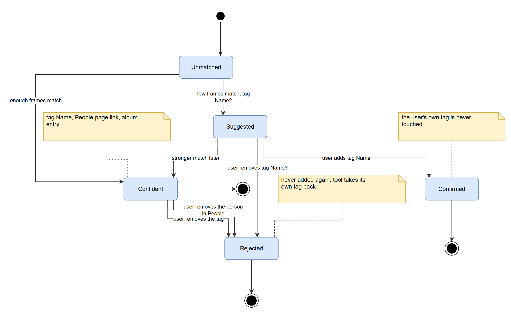

# How to run videotag

1. [What you need](#what-you-need)
2. [Install](#install)
3. [Connect to your NAS](#connect-to-your-nas)
4. [Prepare Photos](#prepare-photos)
5. [First run: a dry run](#first-run-a-dry-run)
6. [First write](#first-write)
7. [Correcting results](#correcting-results)
8. [Run it every day](#run-it-every-day)
9. [Speed: presets and settings](#speed-presets-and-settings)
10. [Looking at part of the library](#looking-at-part-of-the-library)
11. [Checking that the matches are right](#checking-that-the-matches-are-right)
12. [Commands and options](#commands-and-options)
13. [Maintenance](#maintenance)
14. [Troubleshooting](#troubleshooting)

## What you need

| | Required | Notes |
|---|---|---|
| Computer | Windows 10/11 | Developed and tested on Windows 11. The code is portable Python; the credential store and the scheduler instructions are Windows specific. |
| Python | 3.11 or newer | Tested with 3.13. |
| ffmpeg | on `PATH` | Cuts frames out of videos. `ffmpeg -version` must work in the shell the task runs in. |
| NAS | Synology Photos on DSM 7 | Tested on DSM 7.4.1 (DS224+). |
| NAS account | A Photos user with a personal space | Use a **dedicated, non-admin account**. See [security](security.md). |
| GPU | NVIDIA, about 10 GB free memory | Only for the descriptions (model `Qwen3-VL-4B`, 8.9 GB). Without a GPU use `--no-describe`: people tagging runs on the CPU. |
| Disk | About 15 GB | 9 GB for the description model, plus caches that grow with your reference photos. |

## Install

```
git clone <repository-url> videotag
cd videotag

# 1. A CUDA build of PyTorch (skip this if you will always run with --no-describe)
pip install torch --index-url https://download.pytorch.org/whl/cu128

# 2. videotag itself. ".[describe]" adds the description model's libraries; use "." for people only
pip install --no-user -e ".[describe]"
```

Install into **the same Python the scheduled task will use**, into its main `site-packages` (`--no-user`). The task runs Python in *isolated mode* (`-I`) so that stray files in the working directory can never be imported, and isolated mode ignores the per-user package folder. A package installed with `--user` works in your terminal and then fails in the task with `ModuleNotFoundError`.

Find the interpreter's full path, you will need it for the schedule:

```
python -c "import sys; print(sys.executable)"
```

On some machines `python` is a launcher shim and not the interpreter that holds the packages; always use the path printed here.

Check the install:

```
videotag --help
videotag doctor
```

`doctor` checks the install, the data folder, ffmpeg, the stored login, a real NAS login, the face models, the GPU and the description model, the state file and whether a scheduled task exists. `[warn]` lines are fine on a first run (the models are downloaded when first needed); `[FAIL]` lines must be fixed first.

## Connect to your NAS

Create the dedicated account in DSM, give it access to the Synology Photos application, and make sure it has a personal space. Then, **in a terminal window you opened yourself**:

```
videotag credentials set
```

It asks for the account name, the NAS address (`https://nas.example.com`, HTTPS only) and the password (hidden). It logs in once to prove the login works, and only then stores it in Windows Credential Manager. Check with `videotag credentials status` (it never shows the password).

Where the login comes from, and how to use environment variables or secret files instead (containers, CI): [security.md](security.md#the-nas-login).

## Prepare Photos

`videotag` takes its knowledge of who is who from Photos. Before the first run:

1. In Photos, make sure **face recognition / People** is on for the account.
2. Let Photos group the faces in your **photos** and **name the people** in the People view. Videos are not analysed by Photos, so the photos are the reference.
3. Aim for **at least 3 photos per person**. With fewer than 3 reference faces a person only gets `Name?` suggestions, never confident tags. A person's cover face in Photos counts as a starting point.
4. A person who appears only in group photos is fine: faces in group photos are assigned to the people Photos lists on that photo, when that is unambiguous.

`videotag refs` shows which reference faces were found for each person and where they came from.

## First run: a dry run

```
videotag run
```

A dry run reads Photos, downloads and analyses each video (the first time; results are cached), and **writes nothing**. It logs what it *would* do. The first run describes every video and takes a while (about 10 seconds per video on a modern GPU, plus a one-time 9 GB model download, and a long first step that reads the photos of every named person: the log and the dashboard count it as `references: 600 of 2432 photos`). The faces found in those photos are kept, so later runs read only photos that are new or changed, and reuse the video caches too: an unchanged library takes seconds.

Read the log (`%LOCALAPPDATA%\videotag\logs\videotag.log`, rotated) and the JSON report (`reports\`):

```
INFO Alice: 14 references, threshold 0.363, confident tags allowed
INFO Bob: 2 references, threshold 0.426, confident tags not allowed (suggestions only)
INFO 1042 clip.mp4 frames=29 faces=19 | Alice=0.68/11:auto Bob=0.40/0:none
INFO 17 tag change(s) planned (15 confident, 2 suggestions, 0 removals)
INFO plan: add 'Alice' on item 1042
INFO plan: description of video 1042 (679 characters)
INFO dry run: nothing written, pass --apply to write
```

`Alice=0.68/11:auto` reads: best similarity 0.68, 11 matching frames, decision `auto` (confident). Other decisions: `review` (a few frames or thin references, becomes `Alice?`) and `none`.

## First write

Start small, look at the result in Photos, then let it run fully:

```
videotag run --apply --max-writes 5
```

`--max-writes` caps each kind of write (tags, face links, descriptions, album items) per run; without it a run writes at most 100 of each, and what is left waits for the next run. Open a few of the videos in Photos and check the tags, the People page and the description. Then write everything in one run (in the dashboard: tick **No limit** in the run dialog):

```
videotag run --apply --max-writes all
```

If you do not like what happened, `videotag undo` (or **Undo** in the dashboard) removes everything the tool created (and only that).

## Correcting results

You correct everything **in Photos**. The tool reads your edits on the next run and treats them as input.



| You want to | Do this in Photos | What the tool does |
|---|---|---|
| Reject a person on a video | Remove the tag `Name` from the video, **or** remove the person from the video in the People view | Remembers the rejection, takes its own tag and face link back, never adds them again |
| Reject a suggestion | Remove the tag `Name?` | Never suggests that person for that video again; the video leaves the album `videotag: to check` unless another suggestion is still on it |
| Confirm a suggestion | Add the tag `Name` to the video (keep or remove `Name?`) | Treats the video as confirmed, links it on the People page, removes its own `Name?`; the video leaves the album `videotag: to check` unless another suggestion is still on it |
| Add someone it missed | Add the tag `Name` | Same as confirming |
| Remove the generated description | Delete the `[vt] ... [/vt]` block (keep your own text) | Never writes a description for that video again |
| Keep your own wording | Edit inside the block | The block is yours now: left alone, even by `undo` |
| Add your own notes | Write before or after the block | Untouched |
| Teach it a new person | Name the person in Photos' People view | Picked up as a reference on the next run |
| Fix a wrong reference face | Correct it in Photos' People view | Picked up on the next run |

Searching `Name` also finds videos tagged `Name?` (Photos search matches any part of a tag); searching `Name?` lists only the suggestions.

The album `videotag: to check` is the inbox for the suggestions: work through it by confirming or rejecting each video by tag, and it empties itself on the next run. Edit tags, not the album: a video you take out by hand comes back while its suggestion stands.

Versions before this one also made one album per person (named like the person). videotag no longer touches those and does not know about them any more, so `undo` leaves them: delete them in Photos yourself.

## Run it every day

The task runs `python -I -m videotag run --apply` with the full interpreter path. Replace the path with the one printed by `sys.executable`:

```
schtasks /Create /SC DAILY /ST 03:00 /TN videotag /TR "\"C:\Path\To\python.exe\" -I -m videotag run --apply"
```

Things to decide, and know:

- **Logged on or not.** A plain task like this runs only while you are logged on. To run while logged off, create it with a stored password (`/RU <user> /RP`), then check that the credential store is readable in that mode (next section).
- **Missed runs.** If the PC is asleep or off at 03:00 the run is skipped. To catch up when the PC is back, register it with PowerShell instead:

  ```powershell
  $action   = New-ScheduledTaskAction -Execute "C:\Path\To\python.exe" -Argument "-I -m videotag run --apply"
  $trigger  = New-ScheduledTaskTrigger -Daily -At 3am
  $settings = New-ScheduledTaskSettingsSet -StartWhenAvailable -ExecutionTimeLimit (New-TimeSpan -Hours 6)
  Register-ScheduledTask -TaskName videotag -Action $action -Trigger $trigger -Settings $settings
  ```
- **Overlap.** A run holds a lock (`state\run.lock`); a second start while one is running exits with code 2 and does nothing. A running pass refreshes the lock every minute; a lock nobody has refreshed for 6 hours is treated as left over from a crash.
- **Safety.** Run it without `--apply` for a few days first and read the log, then switch.

### Test the task properly

Once everything is cached (including the face crops of the matched videos, which the first run after an update makes), a scheduled run never calls ffmpeg, never loads the model and never downloads anything, which are exactly the things most likely to break under Task Scheduler (shorter `PATH`, different user profile, no console). If a video still needs its crops and ffmpeg is missing, the run logs a warning and keeps the video's saved results; it does not turn it into a failure. So after registering:

1. Force a cache miss for one video: delete its files `state\faces\<id>.npz` and `state\describe\<id>.json` in the data folder.
2. Start the task: `schtasks /Run /TN videotag`.
3. Check `schtasks /Query /TN videotag /V /FO LIST` (**Last Result: 0**) and the end of the log. The log must show that video being processed again.

`videotag doctor` also reads the stored login the way a task would; run it from the same kind of session if you can.

## Dashboard (optional)

```
videotag gui [--port 8765] [--no-browser]
```

Opens a local web page. It needs nothing beyond the normal install, and no run needs it: the dashboard only *reads* the data folder and the log, so it also shows runs started by the scheduled task or a terminal. Leave it running or close it; closing it never affects a run.

| Tab | What you see |
|---|---|
| (top of the page) | The state of the run: starting, learning the faces of your people (photos done, time left), analysing (videos done, current video, time left; "a slice of N" for a limited dry run), planning, writing, finished, or stopped early. For a finished run: how long it took and what it planned or wrote |
| Overview | Videos by result (confident, suggestion, no match, failed), what has been written to Photos, your corrections, a table per person, the files that sit in Photos more than once, how far the matching can be trusted, and the spot-check |
| Videos | Every video of the latest report, or the results of the run in progress as they are made (a "Live view" note says so). Search by file name, person, topic or object, filter by result or person, open a video for the best match score and matching frames per person, the faces the match is based on, the English and German description, topics, objects and place. Chips show where each person stands: tagged, suggested, not written yet (dashed), confirmed by you (✓) or removed by you (✕) |
| Runs | Every saved report with its results, newest first |
| Log | The last lines of the run log, following the newest line |
| Health | The checks of `videotag doctor`, run on request (it logs in to your NAS and takes a few seconds; the first run loads PyTorch into the dashboard process, which holds a little GPU memory until you close the dashboard) |

**Settings** (header) holds the preset every run uses, with what each would save on your library, whether videos are described, and the Re-analyse button. See [speed](#speed-presets-and-settings).

**Start a run** opens a dialog. A *dry run* reads Photos and writes nothing, and can be limited to a slice of the library (a number of videos, only those not analysed yet, or one of your albums; *Load my albums* asks your NAS). *Apply* writes, shows the write cap and the equivalent terminal command, and needs a click on "Apply changes"; it always covers the whole library. The dashboard starts the real `videotag run` as a separate process, so it takes the same run lock as any run: it cannot overlap a scheduled one, and it keeps going if you close the dashboard. **Undo…** (in the header) asks "Remove everything videotag wrote?" first, with Cancel as the default, and then starts the real `videotag undo` the same way: as its own process with the same run lock, so it cannot overlap a run, and its progress and result (what it removed, by kind) show at the top and in the log.

**Account** (the button in the header) shows which Synology account videotag uses and lets you change it: a new password, or another account or NAS. It checks the login against the NAS first and only then stores it, in the same Windows Credential Manager entry as `videotag credentials set`, so both ways behave identically. See [switching accounts](#switching-accounts).

Notes:

- **After updating videotag, close the dashboard window and start it again.** A running dashboard keeps the code it started with, while the page files are read fresh, so an old dashboard can serve a newer page. The page notices and shows a warning ("This page is newer than the dashboard that is running"), and the buttons that need the newer code say so instead of doing nothing.
- The dashboard listens on `127.0.0.1` only. The port is fixed (default 8765) so you can bookmark it; `--port 0` picks a free one. If the port is taken, an earlier dashboard is probably still open.
- It shows file names and descriptions of your videos, so treat the browser tab like the photos themselves. See [security](security.md#the-dashboard).
- Progress comes from the run log (`run started`, `references: ...`, `library: ...`, `slice: ...`, one line per video). A log from before the dashboard existed has no such markers, so the first run after installing only fills them in.
- While a run is going, the Videos and Overview tabs show its results as they are made (`reports\current-run.jsonl`). A run that died leaves that file behind; it is only shown for a run that is still going and began after it, and it never counts as a report.

## Switching accounts

Everything videotag remembers (the state file, the caches, the reports and the log) describes **one account's library**: item ids, tag ids, face ids. Used against another account it would read every tag that is missing there as "removed by you" and remember that for good, and `undo` would delete items by ids that mean something else. So each account has its own copy:

- The active account's data stays where it always was.
- When you switch to another account (in the dashboard, or with `videotag credentials set`), the old account's state, caches, reports and log are **set aside** under `accounts\<name>-<id>\` in the data folder. The new account starts empty, or gets its own earlier data back if you used it before.
- A new password for the *same* account moves nothing.
- Accounts are compared exactly: the NAS address and the account name as typed. `Claude` and `claude` count as two accounts (you can switch back and nothing is lost), because wrongly merging two accounts is the one mistake that cannot be undone.
- Every command that logs in checks first, before any call to the NAS, that the saved data belongs to the login. If not, it stops with `the saved data belongs to X, but the login is for Y` (the dashboard shows "Account needs attention"). This also catches a login from the `VIDEOTAG_*` environment variables.
- Switching waits while a run is in progress. If a folder cannot be moved (Explorer or a virus scanner holds a file in it) everything is put back and you are told to close the program.
- A login from the `VIDEOTAG_*` environment variables takes priority over a stored one, so the dashboard shows it but cannot change it.

**Tags, face links, descriptions and albums that videotag wrote stay in Photos** when you switch away. To remove them, use **Undo** (or run `videotag undo`) while that account is still active, before switching.

## Speed: presets and settings

Every video is cut into frames before the faces are looked for. The **preset** says how densely:

| Preset | Rule | Use it when |
|---|---|---|
| `thorough` (default) | 2 frames a second throughout | You want exactly what earlier versions did |
| `balanced` | 2 a second for the first 30 s, then 1 every 2 s | Long clips are slowing the pass down |
| `fast` | 2 a second for the first 30 s, then 1 every 4 s | Same, and speed matters most |

On the first real library (1,553 videos, a median clip of 16 s) the longest 7% of the clips held 45% of all frames, so `balanced` cuts about 37% of the frames and `fast` about 44%. Clips of 30 s or less are cut the same under every preset. The Settings dialog shows the saving for **your** library, worked out from the results already saved.

**A preset only applies to videos that have no saved result.** Results you already have are kept, whatever preset is chosen; each remembers the rule it was made under. To redo them on purpose, use **Re-analyse** in the Settings dialog (it shows how many videos it touches and about how long it takes before you press it) or `videotag run --reanalyse`. That is a dry run: it re-reads those videos and writes nothing to Photos.

The **settings file** (`settings.json` in the data folder; the Settings dialog or `videotag settings` writes it) holds the standing choices, the preset and whether videos are described, and serves the dashboard, the terminal and a scheduled task alike. A flag on the command line wins for that run (`--preset fast`, `--describe`, `--no-describe`). By design the file never holds how a run writes (`--apply`, `--max-writes`) or what it covers (`--limit`, `--new-only`, `--album`): a file that contains such a choice is refused with a message, so a saved file can never switch writing on or quietly shorten a scheduled run.

## Looking at part of the library

To see what the tool would do without waiting for the whole library, a **dry run** can look at a slice. In the dashboard's run dialog, or on the command line:

```
videotag run --limit 20                 # the first 20 videos
videotag run --limit 20 --new-only      # the first 20 that have no saved result yet: run it again for the next 20
videotag albums                         # lists your own albums with their numbers
videotag run --album 12 --limit 50      # only videos of one of your albums (not the album `videotag: to check` that videotag makes)
```

"Not analysed yet" means the video has its saved results at any frame rate (and a description, if descriptions are on), so changing the preset never makes every video look new. A slice's report holds only that slice, and the dashboard keeps showing the newest report. **A slice is for dry runs only**: `--apply` with `--limit`, `--new-only` or `--album` is refused, and a real run always covers the whole library. The long first step (the reference faces) still runs, but it is kept between runs.

## Checking that the matches are right

Everything here lives in the dashboard's Overview and Videos tabs and needs no NAS.

- **Open in Photos.** A video's file name, in the Videos tab and in the spot-check, is a link that opens that video in the Photos web app in a new browser tab (`https://<your NAS>/?launchApp=SYNO.Foto.AppInstance#/personal_space/folder/<folder>/item/<video>`, the address Photos itself shows for a video opened from its folder). It works on any report, dry run or applied, and needs no person. It is shown only while the saved results belong to the account videotag is logged in as (otherwise it would open another library), and only for reports made since the link was added: older reports did not record the folder, so a new dry run fills it in.
- **Faces behind a match.** Open a video in the Videos tab: under each person the best few faces that made it a match are shown (the crops are kept in `state\evidence` and never uploaded). A video that was analysed before crops existed gets them the next time a run sees that it matches someone, which downloads it once more.
- **Spot-check.** *Draw a sample* picks a random few matches per person (confident ones and suggestions separately) from the latest report. Click a file name to open the video in Photos and look. Matches you already confirmed or removed in Photos, copies of a file and failed videos are left out.
- **How far the matching can be trusted.** Worked out by every run from the reference faces: how many there are and of what kind, the threshold, whether confident tags are allowed, how many of a person's own faces would be recognised, and which people's faces resemble each other (the thresholds are raised to keep those apart).
- **The same file more than once.** Copies with the same name, size and time reuse analysis for results they do not already have. Each video's valid saved faces and description are kept, including results made under different presets; Re-analyse explicitly replaces faces made under another preset. The Overview lists copies so you can delete an extra one in Photos; videotag never deletes a video.

## Commands and options

| Command | What it does |
|---|---|
| `videotag gui` | The optional local dashboard (see above) |
| `videotag run` | One pass over all videos. **Dry run** unless `--apply` |
| `videotag run --apply` | Same, and writes tags, face links, descriptions and albums |
| `videotag undo` | Removes everything the tool created, nothing else |
| `videotag doctor` | Health check for an unattended run (exit code 1 if something is broken) |
| `videotag settings [--preset P] [--describe / --no-describe]` | Show or change the saved settings every run uses |
| `videotag albums` | List your own albums with their numbers, for `run --album` |
| `videotag credentials set / status / delete / migrate` | Manage the stored NAS login |
| `videotag refs` | Show the reference faces found per person and their source |
| `videotag calibrate` | Per-person thresholds, leave-one-out scores, and a local video control |

`run` options:

| Option | Default | Meaning |
|---|---|---|
| `--apply` | off | Write to Photos |
| `--max-writes N` or `all` | 100 | Most changes written per kind per run; `all` has no limit |
| `--preset P` | saved setting, else `thorough` | `thorough`, `balanced` or `fast`: how densely videos without a saved result are cut into frames |
| `--reanalyse` | off | Also redo the saved results that were made under another preset |
| `--min-frames N` | 2 | Matching frames needed for a confident tag |
| `--threshold X` | calibrated per person | One similarity for everyone instead (floor 0.363) |
| `--describe` / `--no-describe` | saved setting, else on | Write descriptions, or skip them (the model is never loaded) |
| `--limit N` | all | Dry run only: look at the first N videos |
| `--new-only` | off | Dry run only: skip videos that already have a saved result |
| `--album ID` | whole library | Dry run only: only the videos of this album of yours |

Exit codes: `0` ok, `1` error (message printed and logged), `2` another run holds the lock.

## Maintenance

**Update:** `git pull`, then `pip install --no-user -e ".[describe]"`, then `videotag doctor`. Existing state, caches and descriptions keep working: saved results made before presets existed are read as `thorough`, so nothing is analysed again. The first run after updating reads the reference photos once more to save their faces, and downloads each video that matches someone once more to cut its face crops. If a future version changes the description format, it recognises the old one and rewrites it.

**Back up** `state\state.json` in the data folder. It records what the tool wrote and your rejections and confirmations; losing it means the tool no longer knows which tags are its own. Caches (`state\faces`, `state\describe`, `state\reffaces`, `state\evidence`, `cache`) can be deleted at any time and are rebuilt; deleting `state\reffaces` makes the next run read the reference photos again, which is the slow first step.

**Move the data folder:** set the `VIDEOTAG_HOME` environment variable (for the user, and for the scheduled task) and move the folder. Default: `%LOCALAPPDATA%\videotag`.

**Change the password:** change it in DSM, then `videotag credentials set` or the Account button of the dashboard (same account: nothing is moved).

**Describe everything again** (for example after a prompt change): delete `state\describe`. Blocks the tool wrote are updated; blocks you edited are left alone.

**Uninstall:**

```
videotag undo                  # removes tags, face links, description blocks, albums created by the tool
videotag credentials delete
pip uninstall videotag
# delete the data folder (%LOCALAPPDATA%\videotag) and the scheduled task: schtasks /Delete /TN videotag
```

## Troubleshooting

| Symptom | Cause and fix |
|---|---|
| `error: no NAS login found` | Run `videotag credentials set`, or set the `VIDEOTAG_*` variables. A task running as another Windows user cannot read your credential store. |
| `ModuleNotFoundError` (for example `yaml`) only in the task | The package is in the per-user folder; isolated mode ignores it. Reinstall with `pip install --no-user`. |
| Task shows nothing in the log | Run the exact command in a terminal; check `schtasks /Query /TN videotag /V /FO LIST` for the last result; check the full interpreter path. |
| `ffmpeg was not found on PATH` | A task can have a shorter `PATH` than your terminal. Put ffmpeg in a system-wide `PATH` folder, or run the task as the user whose `PATH` has it. |
| `PyTorch cannot see a CUDA GPU` | Install a CUDA build of torch (`pip install torch --index-url https://download.pytorch.org/whl/cu128`), update the driver, or use `--no-describe`. |
| CUDA out of memory | Another program is using the GPU. Close it; the model needs about 9 GB. |
| `skipped: another run holds run.lock` (exit 2) | A run is in progress. If none is, delete `state\run.lock` (it is also ignored once nobody has refreshed it for 6 hours). |
| `state file ... is unreadable` | `state\state.json` was edited with a tool that broke it. Restore your backup. Deleting it makes the tool forget which tags are its own. |
| `login failed` or error code 4xx at startup | Wrong or changed password: `videotag credentials set`. Wrong address: it must be `https://...`. Private certificate: set `VIDEOTAG_CA_BUNDLE`. |
| Log shows `add_face ... answered code 117` | Normal for videos whose Photos thumbnail is unusable (some HEVC clips). The tool reads the faces back and only counts what was really stored. |
| A video is not on the person's People page | Look in the log for a `linked to person ... but Photos does not list it` warning. Check that the video carries the tag `Name` (only confident or confirmed matches are linked). |
| `Name?` videos show up when I search `Name` | Expected: Photos search matches any part of a tag. Search `Name?` to see only suggestions. |
| Descriptions missing for some videos | Check the log for `describing ... failed`, run `videotag doctor`. An unusable model answer is cached as "tried"; delete `state\describe\<id>.json` to try again. |
| A person never gets confident tags | They have fewer than 3 reference faces (`videotag refs`). Name more of their photos in Photos. |
| `settings.json: 'apply' is a choice for one run, not a setting` | The settings file may only hold the preset and `describe`. Remove the other key; use the command line or the run dialog for those. |
| File names are not links in the Videos tab | The report was made before links existed (run a dry run again, a `--limit 5` one is enough to see it work), or the saved results belong to another account than the login (the dashboard says "Account needs attention"). |
| `error: --limit, --new-only and --album are for a dry run` | A slice is never applied: a real run covers the whole library. Drop `--apply`, or drop the slice. |
| No face crops under a match | The video was analysed before crops existed and has not been seen by a run since, or it matches nobody. The next run cuts them (one more download of that video). If the log says `evidence of N ... no crops kept` or `could not be made`, the crops cannot be cut for that video's current faces: that is remembered (`state\evidence\<id>\skipped.txt`) so the video is not fetched on every run, and tried again when the video or its faces change. Delete `state\evidence` to try everything again. |
| The dashboard shows "This page is newer than the dashboard that is running" | Close the `videotag gui` window and start it again after an update. |
