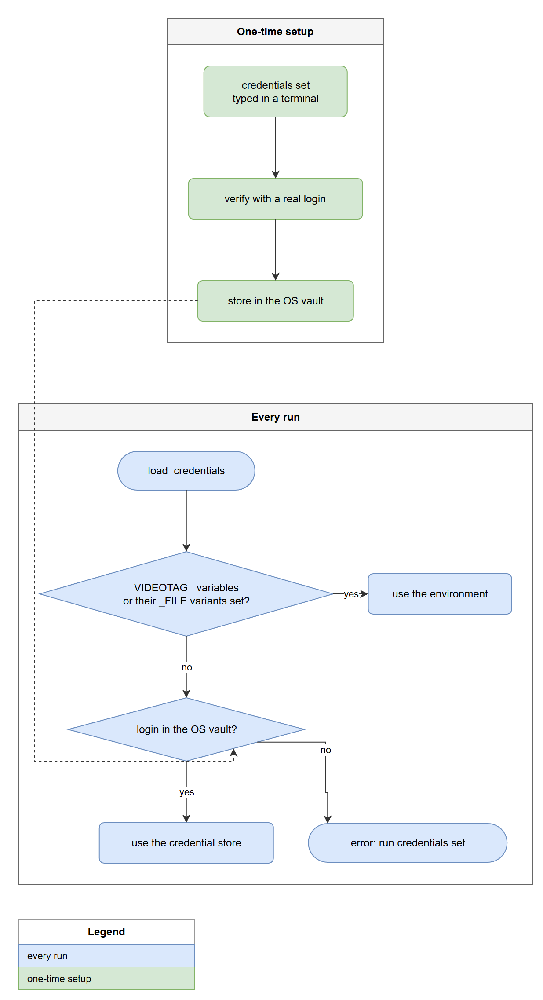

# Security

## The NAS login

The login (address, account, password) is looked up in this order:

1. **Environment**: `VIDEOTAG_URL`, `VIDEOTAG_USER`, `VIDEOTAG_PASSWORD`. Each can instead be a `_FILE` variable holding the path of a file with the value (a Docker or Kubernetes secret): `VIDEOTAG_PASSWORD_FILE=/run/secrets/nas_password`.
2. **The operating system's credential store**, through [keyring](https://pypi.org/project/keyring/): Windows Credential Manager, macOS Keychain or Secret Service. It is encrypted for the logged-in user.



There is **no plaintext file fallback**, and `videotag` refuses to run on a machine whose keyring has no real backend (instead of quietly using a plaintext one).

```
videotag credentials set       # typed in a terminal (the password is not echoed, never a command-line argument),
                               # verified with a real login, then stored
videotag credentials status    # shows the source, address and account, never the password
videotag credentials delete
videotag credentials migrate old-creds.txt --delete   # one-time move from an old plaintext file; the file is
                                                      # deleted only after a login from the vault worked
```

Rules the code follows:

- The password is never written to the repository, the data folder, a log, a report or an error message. `Credentials.__repr__` hides it. Request errors never include URLs or form data (they carry the password and the session id).
- The address must be `https://`. Plain `http://` is refused unless `VIDEOTAG_ALLOW_INSECURE_HTTP=1` is set for a trusted test network.
- Certificates are always verified. A NAS with a private certificate authority or a self-signed certificate is trusted by pointing `VIDEOTAG_CA_BUNDLE` at its certificate file, never by switching verification off.
- The unit tests run against an in-memory vault and a guard test fails if they ever see the real one, so tests cannot overwrite the live login.

### Recommended setup

- **Use a dedicated NAS account** for this tool, not an administrator. It needs access to the Photos personal space whose videos you want processed, nothing else. It does not need DSM admin rights.
- **Rotate the password** (change it in DSM, then run `videotag credentials set`) whenever it may have been exposed: pasted into a chat, shown on screen, committed by mistake.
- Windows Credential Manager entries belong to one Windows user. A scheduled task must run as **that same user**. `videotag doctor` reads the secret the same way a task would; test a registered task once (see the how-to).

## What the tool keeps, and where

Everything lives in one data folder (`%LOCALAPPDATA%\videotag`, or `VIDEOTAG_HOME`), outside the source tree:

| Folder | Contents | Sensitivity |
|---|---|---|
| `state/state.json` | The tags, face links, descriptions and albums the tool created, and your rejections and confirmations | Low (ids and names) |
| `state/faces/` | Face embeddings and positions found in each video | **Biometric data**: treat like the photos themselves. Safe to delete, it is rebuilt |
| `state/describe/` | The generated description text per video | Describes your videos; safe to delete |
| `cache/` | Original reference photos and cover crops downloaded from Photos | **Personal photos**. Safe to delete |
| `models/` | Face detection and recognition models | None |
| `logs/`, `reports/` | What each run did: file names, scores, descriptions | Describes your videos |

Videos themselves are downloaded to a temporary folder, processed and deleted again within the same step.

## What leaves the machine

- Requests to **your NAS** (HTTPS): reading the library, downloading originals, writing tags, faces, descriptions and albums.
- **One-time downloads**: the OpenCV face models from `github.com/opencv/opencv_zoo`, and the description model `Qwen/Qwen3-VL-4B-Instruct` from Hugging Face (about 9 GB), plus Python packages at install time.
- Nothing else: no telemetry, no cloud AI service. Faces, frames and descriptions are processed locally.

## The dashboard

`videotag gui` (optional) is a small web server inside your own Python process. It never sees the NAS password: it reads the data folder, and anything that needs the NAS (the health check, a run) uses the same credential store as the command line, in the process that does the work.

- **Loopback only.** It listens on `127.0.0.1`, never on a network address, and there is no option to change that.
- **Other websites cannot read it.** A request whose `Host` header is not `127.0.0.1:<port>` or `localhost:<port>` is refused (this stops DNS rebinding), responses carry no CORS headers, and the page is sent with `Cross-Origin-Resource-Policy: same-origin`, `X-Content-Type-Options: nosniff`, `Cache-Control: no-store` and a Content-Security-Policy of `default-src 'self'` with `frame-ancestors 'none'` (no inline script, no external resources, no framing).
- **Other websites cannot start a run.** Every POST needs a random per-session token that only the served page contains, plus a matching `Origin` when the browser sends one. Starting an apply run needs a click on a confirmation dialog; `undo` is not available from the page.
- **No injection from your data.** File names, descriptions and log lines (descriptions come from a model and can be edited in Photos) are put into the page as text, never as HTML.
- **The account form handles a password.** The password you type travels once, in the body of a request to `127.0.0.1` (HTTP on the loopback interface, so it never leaves the PC), is checked against the NAS over HTTPS, and is then stored in the Windows Credential Manager exactly as `videotag credentials set` does. The server never writes it to a log, a file or an error message and never sends it back (the account view shows only the address and the account name). The field is `type="password"` with `autocomplete="new-password"` so the browser does not offer to save it, and it is emptied after every attempt and when the dialog closes. Only `https://` addresses are accepted, and certificates are always verified. The form is disabled while the login comes from environment variables, because those would override the stored one.
- **What it exposes** to anyone who can use your browser session: the file names and descriptions of your videos, who was matched, and the log. Treat the open tab like the photos themselves.

## Reporting a problem

If you find a security issue, do not open a public issue with details; contact the repository owner directly.
